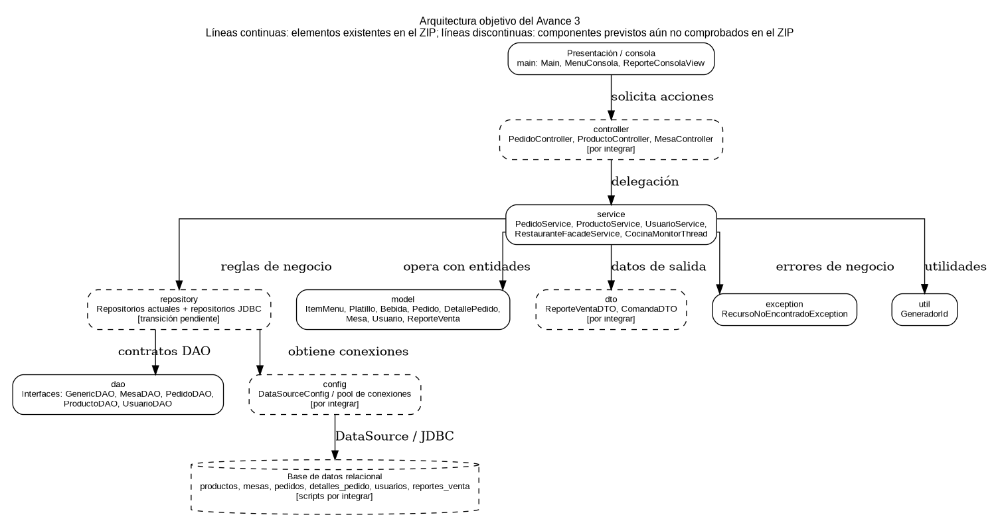
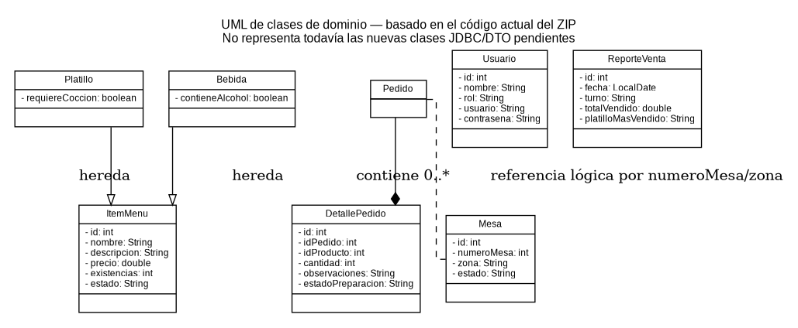

# Sistema de Gestión de Restaurante

Aplicación para administrar la operación diaria de un restaurante: catálogo de productos, mesas, pedidos con su detalle, usuarios y reportes de venta. El proyecto se desarrolló en equipo (Grupo 3) en cinco fases secuenciales, desde el diseño de la base de datos hasta el cierre y la documentación.

## Tabla de contenido

1. [Equipo](#equipo)
2. [Tecnologías](#tecnologías)
3. [Estructura del repositorio](#estructura-del-repositorio)
4. [Arquitectura](#arquitectura)
5. [Modelo de datos](#modelo-de-datos)
6. [Requisitos previos](#requisitos-previos)
7. [Instalación y ejecución local](#instalación-y-ejecución-local)
8. [Configuración](#configuración)
9. [Fases del proyecto](#fases-del-proyecto)
10. [Flujo de trabajo con Git](#flujo-de-trabajo-con-git)
11. [Solución de problemas](#solución-de-problemas)

## Equipo

| Integrante | Fase | Responsabilidad |
|---|---|---|
| Jason Valladares | 1 | Scripts `schema.sql` y `data.sql` (junto con Vidal); `DataSourceConfig.java` con los 15 parámetros del pool de conexiones |
| Vidal Mejía | 1 y 5 | Scripts `schema.sql` y `data.sql`; README exhaustivo y validación de la ejecución local y los scripts |
| Lucas Amaya | 1 y 5 | Estructura final de paquetes; exportación de `docs/uml.png` y `docs/arquitectura.png` |
| Alejandra Rivera | 2 | `ProductoRepositoryJDBC` con jerarquía polimórfica de `ItemMenu` (`Platillo` y `Bebida`) |
| Tatiana Córdova | 2 | `MesaRepositoryJDBC` y estados de mesa (`DISPONIBLE`, `OCUPADA`) |
| José Alfredo Rodríguez | 2 | DTOs `ReporteVentaDTO` y `ComandaDTO`; `ReporteVentaRepositoryJDBC` |
| Wilfredo Martínez | 3 y 4 | Servicios transaccionales (`ProductoService`, `MesaService`, `PedidoService`); controladores (`PedidoController`, `ProductoController`, `MesaController`) |
| Eduardo Rodríguez | 3 | `CocinaMonitorThread`: hilo en segundo plano que consulta comandas en la base de datos |
| Ashley Escobar | 3 | Auditoría y refactorización de servicios y repositorios (ejemplos "Antes vs. Después") |
| Alisson Lovo | 4 | Vistas de cliente y mesero: menú por categorías (HU-005) y toma de pedidos por mesa (HU-002) |
| Rafael Ochoa | 4 | Vistas de cocina, bar y caja (HU-003, HU-004); módulo de cobro y corte de caja |
| Frery Vásquez | 5 | Pruebas unitarias con JUnit y Mockito sobre `ProductoService` y `PedidoService` |
| Julia Luna | 5 | Pruebas End-to-End (Mesa, Pedido, Cocina, Caja, Reporte) y prueba de estrés del pool |

## Tecnologías

- **Lenguaje:** Java 17 o superior
- **Base de datos:** MySQL 8.0
- **Persistencia actual:** repositorios en memoria (`HashMap`); los scripts de `database/` preparan la base MySQL para la capa JDBC prevista en las fases 2 y 3
- **Pruebas:** pruebas manuales (`ProductoServiceTest`); JUnit y Mockito previstos en la Fase 5
- **Gestión de dependencias / build:** ninguno; la compilación se hace directamente con `javac`
- **Control de versiones:** Git y GitHub

## Estructura del repositorio

```
sistema-restaurante-grupo3/
├── database/            # Scripts SQL (schema.sql, data.sql)
└── restaurante-app/     # Aplicación Java
    ├── docs/            # Diagramas (uml.png, arquitectura.png)
    └── src/             # Código fuente (com.sv.grupo3.restaurante)
```

### Paquetes de la aplicación

| Paquete | Propósito |
|---|---|
| `model` | Entidades: `Producto`, `Mesa`, `Pedido`, `DetallePedido`, `Usuario`, `ReporteVenta` |
| `dao` | Interfaces CRUD por entidad |
| `repository` | Implementación en memoria de los DAO (`HashMap`) |
| `service` | Lógica de negocio (HU-001 a HU-004) |
| `util` | Utilidades (`GeneradorId`) |
| `exception` | Excepciones (`RecursoNoEncontradoException`) |
| `main` | `Main.java`, demo funcional |
| `test` | `ProductoServiceTest.java`, pruebas manuales |

## Arquitectura

La aplicación sigue una arquitectura en capas: `service` contiene la lógica de negocio y usa los `dao` (interfaces) implementados en `repository`, con `model` como entidades compartidas.



Diagrama de clases:



## Modelo de datos

El esquema se define en `database/schema.sql` y contiene las siguientes tablas:

| Tabla | Descripción |
|---|---|
| `productos` | Catálogo de platillos y bebidas |
| `mesas` | Mesas del restaurante |
| `pedidos` | Pedidos realizados |
| `detalles_pedido` | Líneas de cada pedido (producto y cantidad) |
| `usuarios` | Usuarios del sistema |
| `reportes_venta` | Reportes de ventas |

`database/data.sql` carga los datos semilla para poder probar el sistema desde el primer arranque.

## Requisitos previos

- JDK 17 o superior
- MySQL 8.0 en ejecución (para cargar los scripts de `database/`)
- No se requiere Maven ni Gradle
- Git

## Instalación y ejecución local

1. **Clonar el repositorio**

   ```bash
   git clone https://github.com/STERBEN31GUN/sistema-restaurante-grupo3.git
   cd sistema-restaurante-grupo3
   ```

2. **Crear la base de datos y cargar los datos**

   ```bash
   mysql -u <usuario> -p -e "CREATE DATABASE IF NOT EXISTS <nombre_bd>;"
   mysql -u <usuario> -p <nombre_bd> < database/schema.sql
   mysql -u <usuario> -p <nombre_bd> < database/data.sql
   ```

   El orden importa: primero `schema.sql` (crea las tablas) y después `data.sql` (inserta los datos).

3. **Configurar la conexión** (ver [Configuración](#configuración)).

4. **Compilar y ejecutar la aplicación**

   ```bash
   cd restaurante-app
   mkdir -p bin
   find src -name "*.java" > sources.txt
   javac -d bin -encoding UTF-8 @sources.txt
   java -cp bin com.sv.grupo3.restaurante.main.Main

   # Pruebas manuales
   java -ea -cp bin com.sv.grupo3.restaurante.test.ProductoServiceTest
   ```

5. **Verificar** que `Main` se ejecuta sin errores y que la prueba manual termina sin fallos.

## Configuración

La versión actual funciona en memoria y no requiere conexión. Cuando se integre la capa JDBC, la conexión se configurará mediante `DataSourceConfig` (pool de conexiones) con estos parámetros:

| Parámetro | Descripción | Ejemplo |
|---|---|---|
| URL | Cadena de conexión JDBC | `jdbc:mysql://localhost:3306/<nombre_bd>` |
| Usuario | Usuario de MySQL | `root` |
| Contraseña | Contraseña de MySQL | no subir al repositorio |

> **Importante:** no subas contraseñas reales al repositorio.

## Fases del proyecto

El trabajo se organizó en 5 fases secuenciales para evitar bloqueos por dependencias entre capas.

| Fase | Contenido | Depende de |
|---|---|---|
| 1. Infraestructura y base de datos | `schema.sql`, `data.sql`, `DataSourceConfig.java` y estructura de paquetes | Ninguna (fase inicial) |
| 2. Persistencia relacional | Repositorios JDBC de productos, mesas y reportes de venta; DTOs | Fase 1 |
| 3. Lógica de negocio y concurrencia | Servicios con transacciones ACID (`setAutoCommit(false)`, `commit`, `rollback`); `CocinaMonitorThread`; refactorización | Fase 2 |
| 4. Controladores e interfaz | Controladores y vistas de cliente, mesero, cocina, bar y caja | Fase 3 |
| 5. Calidad, despliegue y cierre | Pruebas unitarias y End-to-End, prueba de estrés del pool, README y diagramas | Código integrado en `main` mediante Pull Requests |

La documentación técnica completa del Avance 3 está en el documento de Google Docs del grupo.

## Flujo de trabajo con Git

- Rama principal: `main`.
- Cada parte nueva se trabaja en una rama `feature/<nombre>` (por ejemplo `feature/database-schema`).
- Los cambios se integran a `main` mediante Pull Request.

## Solución de problemas

| Problema | Posible causa y solución |
|---|---|
| `Access denied for user` | Usuario o contraseña incorrectos en la configuración de conexión |
| `Unknown database` | Falta crear la base de datos antes de ejecutar `schema.sql` |
| `Table doesn't exist` | Se ejecutó `data.sql` antes que `schema.sql` |
| Error de conexión al arrancar | MySQL no está corriendo o el puerto es distinto de 3306 |
